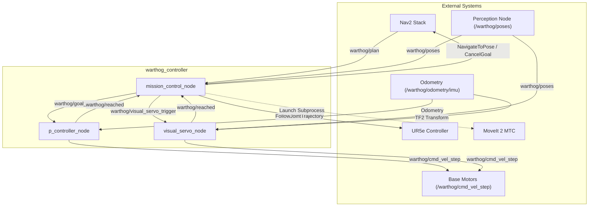
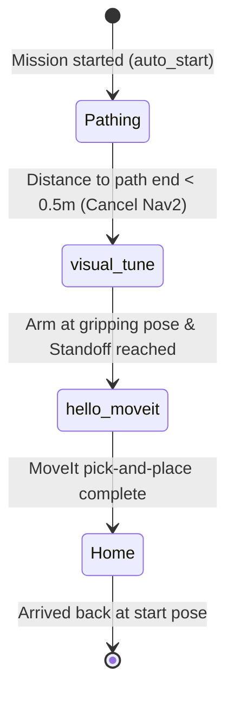

# Warthog Controller (`warthog_controller`)

A ROS 2 package providing high-level mission orchestration, odometry-based proportional waypoint navigation, and vision-guided docking for the **Clearpath Warthog UGV** equipped with a **Universal Robots UR5e manipulator**.

---

## Architecture Overview

`warthog_controller` coordinates low-level platform locomotion, Nav2 global path tracking, vision-based object detection, and MoveIt 2 robotic arm manipulation.



---

## Core Nodes

### 1. `mission_control_node`
Coordinates the autonomous mission workflow via an internal finite-state machine (FSM):



- **`Pathing`**: Monitors Nav2 path execution (`warthog/plan`), saves the starting position, and cancels Nav2 once within 0.5 m of the target to hand off control.
- **`visual_tune`**: Commands the UR5e arm to a gripping/scanning pose via `FollowJointTrajectory`, then enables visual servoing.
- **`hello_moveit`**: Launches the MoveIt 2 pick-and-place pipeline (`ros2 launch hello_moveit pick_place_ur5e.launch.py`).
- **`Home`**: Dispatches a `NavigateToPose` action goal to drive the Warthog back to its initial start position.

### 2. `p_controller_node`
Closed-loop proportional waypoint navigation using filtered odometry:
- **Frame Auto-Detection**: Accepts target poses expressed in either the robot base frame (`warthog/base_link`, relative) or global frame (`odom`).
- **Two-Stage Movement**: Pivots in place when heading error $> 45^\circ$, then drives forward with proportional speed scaling before aligning final target yaw.
- Also registered under the alias `slow_controller_node`.

### 3. `visual_servo_node`
Vision-guided docking controller that drives the Warthog base toward detected 3D object poses (`warthog/poses`), maintaining a configurable standoff distance (default: `1.40 m`) and heading alignment.

---

## Build & Installation

```bash
# Source ROS 2 (e.g., Jazzy)
source /opt/ros/jazzy/setup.bash

# Build the package from your colcon workspace
colcon build --symlink-install --packages-select warthog_controller

# Source the workspace overlay
source install/setup.bash
```

---

## Quick Start

### Running the Nodes

```bash
# 1. Proportional waypoint controller
ros2 run warthog_controller p_controller_node

# 2. Visual servo controller
ros2 run warthog_controller visual_servo_node

# 3. Mission control coordinator
ros2 run warthog_controller mission_control_node
```

> **Tip**: Any parameter can be overridden at launch, for example:  
> `ros2 run warthog_controller visual_servo_node --ros-args -p standoff_distance:=1.20`

---

## Usage Examples

### Trigger Autonomous Sequence
Manually trigger the arm repositioning and advance the autonomous sequence:
```bash
ros2 topic pub --once warthog/start_trigger std_msgs/msg/Bool "{data: true}"
```

### Send Manual Waypoints to P-Controller
**Relative goal (2 meters straight ahead):**
```bash
ros2 topic pub --once warthog/goal_pose geometry_msgs/msg/PoseStamped '{
  header: {frame_id: "warthog/base_link"},
  pose: {
    position: {x: 2.0, y: 0.0, z: 0.0},
    orientation: {x: 0.0, y: 0.0, z: 0.0, w: 1.0}
  }
}'
```

**Global goal in odometry frame:**
```bash
ros2 topic pub --once warthog/goal_pose geometry_msgs/msg/PoseStamped '{
  header: {frame_id: "odom"},
  pose: {
    position: {x: 5.0, y: 1.5, z: 0.0},
    orientation: {x: 0.0, y: 0.0, z: 0.7071, w: 0.7071}
  }
}'
```

### Test Visual Servoing
```bash
# 1. Enable visual servo mode
ros2 topic pub --once warthog/visual_servo_trigger std_msgs/msg/Bool "{data: true}"

# 2. Publish synthetic target detection (2m ahead, 0.3m left)
ros2 topic pub --once warthog/poses geometry_msgs/msg/PoseArray '{
  header: {frame_id: "warthog/base_link"},
  poses: [{
    position: {x: 2.0, y: 0.3, z: 0.0},
    orientation: {x: 0.0, y: 0.0, z: 0.0, w: 1.0}
  }]
}'
```

---

## Key Interfaces & Parameters

### Primary ROS Topics & Actions

| Interface | Type | Direction / Role | Description |
|---|---|---|---|
| `warthog/cmd_vel_step` | `geometry_msgs/msg/Twist` | Published by `p_controller`, `visual_servo` | Platform velocity commands |
| `warthog/goal_pose` | `geometry_msgs/msg/PoseStamped` | Subscribed by `p_controller` / Published by `mission_control` | Target waypoint pose (base or odom frame) |
| `warthog/poses` | `geometry_msgs/msg/PoseArray` | Subscribed by `visual_servo`, `mission_control` | Detected 3D object poses |
| `warthog/reached` | `std_msgs/msg/Bool` | Published by `p_controller`, `visual_servo` | Goal arrival / standoff reached confirmation |
| `warthog/start_trigger` | `std_msgs/msg/Bool` | Subscribed by `mission_control` | Triggers arm staging and mission progression |
| `warthog/visual_servo_trigger` | `std_msgs/msg/Bool` | Published by `mission_control` / Sub by `visual_servo` | Enables/disables visual servo tracking |
| `warthog/plan` | `nav_msgs/msg/Path` | Subscribed by `mission_control` | Nav2 global plan monitoring |
| `.../follow_joint_trajectory` | `control_msgs/action/FollowJointTrajectory` | Action Client: `mission_control` | Moves UR5e arm to scan/grip pose |
| `warthog/navigate_to_pose` | `nav2_msgs/action/NavigateToPose` | Action Client: `mission_control` | Dispatches goal to return UGV to home pose |

### Key Parameters

| Node | Parameter | Default | Description |
|---|---|---|---|
| `p_controller_node` | `kp_linear` / `kp_angular` | `0.5` / `1.0` | Proportional translation and steering gains |
| | `max_linear_speed` / `max_angular_speed` | `0.5` m/s / `1.0` rad/s | Maximum velocity limits |
| | `dist_tolerance` / `yaw_tolerance` | `0.2` m / `0.1` rad | Goal arrival thresholds |
| `visual_servo_node` | `standoff_distance` | `1.40` m | Desired stopping distance from target object |
| | `dist_tolerance` | `0.2` m | Standoff convergence threshold |
| | `max_linear_speed` / `max_angular_speed` | `0.2` m/s / `0.2` rad/s | Maximum docking velocity limits |
| `mission_control_node` | `auto_start` | `true` | Automatically begin state machine on startup |

---

## Repository Structure

```
WarthogController/
├── README.md
└── warthog_controller/
    ├── package.xml
    ├── setup.py
    └── warthog_controller/
        ├── mission_control.py   # State machine orchestrator & subprocess launcher
        ├── p_controller.py      # Odometry waypoint controller
        └── visual_servo.py      # Vision-guided docking controller
```

---

## License

This package is licensed under the Apache-2.0 License. See [LICENSE](file:///rb_ws/src/harry_ws/WarthogController/warthog_controller/LICENSE) for details.
