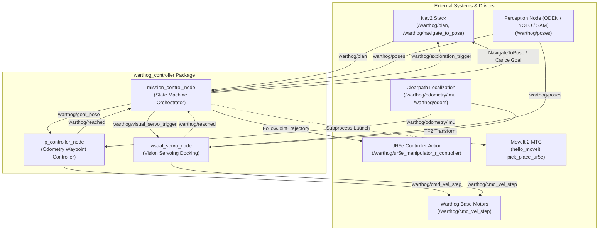
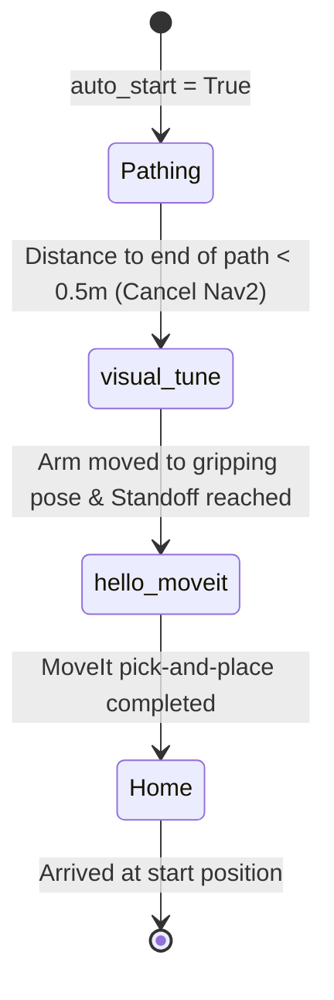

# Warthog Controller (`warthog_controller`)

A ROS 2 package providing high-level mission orchestration, odometry-based proportional waypoint navigation, and vision-guided servoing for the **Clearpath Warthog Unmanned Ground Vehicle (UGV)** equipped with a **Universal Robots UR5e manipulator** and vision perception systems.

---

## Table of Contents

- [Overview](#overview)
- [System Architecture](#system-architecture)
- [Nodes and Modules](#nodes-and-modules)
  - [1. Mission Control Node (`mission_control_node`)](#1-mission-control-node-mission_control_node)
  - [2. Proportional Navigation Controller (`p_controller_node`)](#2-proportional-navigation-controller-p_controller_node)
  - [3. Visual Servoing Controller (`visual_servo_node`)](#3-visual-servoing-controller-visual_servo_node)
- [ROS Interfaces Summary](#ros-interfaces-summary)
  - [Subscribed Topics](#subscribed-topics)
  - [Published Topics](#published-topics)
  - [Action Servers & Clients](#action-servers--clients)
  - [Service Clients](#service-clients)
- [Parameters Configuration](#parameters-configuration)
- [Prerequisites & Dependencies](#prerequisites--dependencies)
- [Build & Installation](#build--installation)
- [Quick Start & Usage](#quick-start--usage)
  - [Running the Nodes](#running-the-nodes)
  - [Triggering Autonomous Execution](#triggering-autonomous-execution)
  - [Sending Manual Navigation Goals](#sending-manual-navigation-goals)
  - [Testing Visual Servoing](#testing-visual-servoing)
- [Repository Structure](#repository-structure)
- [License](#license)

---

## Overview

The `warthog_controller` package acts as the bridge between low-level platform locomotion, Nav2 global path planning, real-time visual perception, and robotic arm manipulation (MoveIt 2).

It is organized into three core nodes:
1. **`mission_control_node`**: High-level finite-state machine (FSM) manager that sequences autonomous operations across navigation, robotic arm pre-positioning, visual servoing, perception-guided pick-and-place, and returning to the base.
2. **`p_controller_node`** (with alias `slow_controller_node`): Closed-loop proportional controller for precise waypoint driving using filtered odometry, featuring pivot-in-place turns and coordinate-frame auto-transformation (robot base frame vs. global odometry frame).
3. **`visual_servo_node`**: Eye-to-hand / base-to-target visual servo controller that docks the Warthog base at a designated standoff distance and heading relative to object detections received from onboard cameras and perception models.

---

## System Architecture

The following diagram illustrates the interaction between nodes in `warthog_controller` and external ROS 2 components:



---

## Nodes and Modules

### 1. Mission Control Node (`mission_control_node`)

**Source**: [`warthog_controller/mission_control.py`](file:///rb_ws/src/harry_ws/WarthogController/warthog_controller/warthog_controller/mission_control.py)

#### Mission State Machine
The node runs an internal `MissionLog` state machine that transitions through sequential stages:



- **`Pathing`**: Subscribes to Nav2's global plan on `warthog/plan`. Caches the initial position (`startOfPath`) for the return journey. Monitors the distance between the robot's current pose (retrieved via TF `warthog/map` &rarr; `warthog/base_link`) and the path end (`endOfPath`). When within `distance_tolerance` (0.5 m), it cancels the active Nav2 goal via `CancelGoal` service and transitions to `visual_tune`.
- **`visual_tune`**: Commands the UR5e right arm to a predefined scanning/gripping pose (`[-1.5359, -1.885, 2.1293, -4.8171, -0.2793, 1.4835]` rad) via the `FollowJointTrajectory` action client. Once in position, it pauses to stabilize camera feeds and activates `visual_servo_node` via `warthog/visual_servo_trigger`.
- **`hello_moveit`**: Verifies arm readiness and launches the perception and MoveIt Task Constructor pick-and-place pipeline (`ros2 launch hello_moveit pick_place_ur5e.launch.py`) in a managed subprocess.
- **`Home`**: Sends an action goal to Nav2 (`warthog/navigate_to_pose`) with the saved `startOfPath` pose to automatically drive the Warthog back to its departure point.
- **`explore`**: Toggles autonomous frontier exploration via `warthog/exploration_trigger`.

---

### 2. Proportional Navigation Controller (`p_controller_node`)

**Source**: [`warthog_controller/p_controller.py`](file:///rb_ws/src/harry_ws/WarthogController/warthog_controller/warthog_controller/p_controller.py)  
**Aliases**: `p_controller_node`, `slow_controller_node`

An odometry-based closed-loop controller designed for short-range waypoint execution and precise local docking.

#### Key Features:
- **Frame Auto-Detection & Transformation**:
  - If target `frame_id` contains `base` (or matches parameter `base_frame`), the controller computes target coordinates in the global odometry frame using:
    $$\begin{aligned}
    x_{goal} &= x_{robot} + (x_{rel} \cos\theta - y_{rel} \sin\theta) \\
    y_{goal} &= y_{robot} + (x_{rel} \sin\theta + y_{rel} \cos\theta) \\
    \theta_{goal} &= \text{normalize}(\theta_{robot} + \theta_{rel})
    \end{aligned}$$
  - If expressed in global/odom frame, coordinates are tracked directly.
- **Two-Stage Control Law**:
  1. **Position Stage** ($e_{dist} > \text{dist\_tolerance}$):
     - Computes heading error to target position: $\theta_{err} = \text{normalize}(\text{atan2}(\Delta y, \Delta x) - \theta)$.
     - **In-place Pivot**: If $|\theta_{err}| > 45^\circ$ ($\frac{\pi}{4}$), linear velocity is locked to $0.0\text{ m/s}$ to pivot in place first.
     - **Smooth Approach**: If $|\theta_{err}| \le 45^\circ$, commands forward speed scaled by heading alignment:
       $$v_x = \text{clamp}(k_{p,\text{linear}} \cdot e_{dist} \cdot \cos(\theta_{err}), -v_{max}, v_{max})$$
       $$\omega_z = \text{clamp}(k_{p,\text{angular}} \cdot \theta_{err}, -\omega_{max}, \omega_{max})$$
  2. **Orientation Alignment Stage** ($e_{dist} \le \text{dist\_tolerance}$):
     - Sets $v_x = 0.0\text{ m/s}$.
     - Rotates base to match desired target yaw $\theta_{goal}$:
       $$\omega_z = \text{clamp}(k_{p,\text{angular}} \cdot \text{normalize}(\theta_{goal} - \theta), -\omega_{max}, \omega_{max})$$
  3. **Completion**:
     - Halts vehicle with zero velocity.
     - Publishes `True` on `warthog/reached`.
     - After 5 stationary control loops, idles until a new goal arrives.

---

### 3. Visual Servoing Controller (`visual_servo_node`)

**Source**: [`warthog_controller/visual_servo.py`](file:///rb_ws/src/harry_ws/WarthogController/warthog_controller/warthog_controller/visual_servo.py)

Aligns the Warthog base directly with objects detected by onboard perception models (e.g. YOLO, SAM, or ODEN point clouds).

#### Key Features:
- **TF2 Integration**: Transforms detected poses from optical/camera frames directly into `warthog/base_link`.
- **Standoff Distance Regulation**: Drives toward an offset distance (default `1.40` m) directly facing the object:
  $$e_{dist} = \sqrt{x_{rel}^2 + y_{rel}^2} - d_{standoff}$$
  $$\theta_{target} = \text{atan2}(y_{rel}, x_{rel})$$
- **Convergence Handling**: Once the standoff error is within `dist_tolerance` for 5 consecutive detection cycles, the robot brakes and reports completion on `warthog/reached`.

---

## ROS Interfaces Summary

### Subscribed Topics

| Topic | Type | Handled By Node | Description |
|---|---|---|---|
| `warthog/start_trigger` | `std_msgs/msg/Bool` | `mission_control_node` | Trigger to initiate arm movement to gripping pose and start workflow |
| `warthog/plan` | `nav_msgs/msg/Path` | `mission_control_node` | Nav2 planned path used to monitor arrival and record start pose |
| `warthog/reached` | `std_msgs/msg/Bool` | `mission_control_node` | Signals completion from P-controller or visual servo node |
| `warthog/poses` | `geometry_msgs/msg/PoseArray` | `mission_control_node`, `visual_servo_node` | Detected object 3D poses from vision perception |
| `warthog/odometry/imu` | `nav_msgs/msg/Odometry` | `mission_control_node`, `p_controller_node` | Primary filtered robot odometry |
| `warthog/odom` | `nav_msgs/msg/Odometry` | `p_controller_node` | Fallback odometry if IMU-fused odometry is unavailable |
| `warthog/goal_pose` | `geometry_msgs/msg/PoseStamped` | `p_controller_node` | Target waypoint (supports relative base or global odom frame) |
| `warthog/new_position` | `geometry_msgs/msg/PoseStamped` | `p_controller_node` | Secondary/legacy waypoint target topic |
| `warthog/visual_servo_trigger` | `std_msgs/msg/Bool` | `visual_servo_node` | Enables (`True`) or disables (`False`) visual servo tracking |

### Published Topics

| Topic | Type | Published By Node | Description |
|---|---|---|---|
| `warthog/cmd_vel_step` | `geometry_msgs/msg/Twist` | `p_controller_node`, `visual_servo_node` | Velocity commands for the Warthog mobile base |
| `warthog/reached` | `std_msgs/msg/Bool` | `p_controller_node`, `visual_servo_node` | Notifies state machine of goal or standoff arrival |
| `warthog/goal_pose` | `geometry_msgs/msg/PoseStamped` | `mission_control_node` | Waypoint poses dispatched to the P-controller |
| `warthog/exploration_trigger` | `std_msgs/msg/Bool` | `mission_control_node` | Starts/stops autonomous frontier exploration |
| `warthog/visual_servo_trigger` | `std_msgs/msg/Bool` | `mission_control_node` | Enables/disables visual servo node |

### Action Servers & Clients

| Action Name | Type | Client Node | Description |
|---|---|---|---|
| `warthog/ur5e_manipulator_r_controller/follow_joint_trajectory` | `control_msgs/action/FollowJointTrajectory` | `mission_control_node` | Moves UR5e right arm to designated gripping/scanning pose |
| `warthog/navigate_to_pose` | `nav2_msgs/action/NavigateToPose` | `mission_control_node` | Dispatches navigation goal to return robot to initial home pose |

### Service Clients

| Service Name | Type | Client Node | Description |
|---|---|---|---|
| `warthog/navigate_to_pose/_action/cancel_goal` | `action_msgs/srv/CancelGoal` | `mission_control_node` | Cancels current Nav2 navigation when path endpoint is reached |

---

## Parameters Configuration

### `mission_control_node`

| Parameter | Type | Default | Description |
|---|---|---|---|
| `exploration_trigger` | string | `warthog/exploration_trigger` | Topic to start/stop exploration |
| `visual_servo_trigger` | string | `warthog/visual_servo_trigger` | Topic to enable/disable visual servoing |
| `reached_topic` | string | `warthog/reached` | Feedback topic indicating task completion |
| `goal_topic` | string | `warthog/goal_pose` | Topic used to dispatch waypoint goals |
| `camera_feedback` | string | `warthog/poses` | Topic receiving detected object poses |
| `path_feedback` | string | `warthog/plan` | Nav2 global path feedback topic |
| `auto_start` | bool | `true` | Automatically begin state machine on startup |

### `p_controller_node`

| Parameter | Type | Default | Description |
|---|---|---|---|
| `cmd_vel_topic` | string | `warthog/cmd_vel_step` | Velocity output topic |
| `odom_topic` | string | `warthog/odometry/imu` | Primary odometry input topic |
| `goal_topic` | string | `warthog/goal_pose` | Target goal pose input topic |
| `new_pos_topic` | string | `warthog/new_position` | Secondary goal pose input topic |
| `reached_topic` | string | `warthog/reached` | Goal reached publication topic |
| `kp_linear` | float | `0.5` | Proportional gain for linear translation |
| `kp_angular` | float | `1.0` | Proportional gain for angular steering |
| `dist_tolerance` | float | `0.2` (m) | Distance error tolerance |
| `yaw_tolerance` | float | `0.1` (rad) | Yaw orientation error tolerance (~5.7°) |
| `max_linear_speed` | float | `0.5` (m/s) | Maximum forward/reverse linear speed |
| `max_angular_speed` | float | `1.0` (rad/s) | Maximum rotation speed |
| `control_rate` | float | `10.0` (Hz) | Control loop execution frequency |
| `base_frame` | string | `warthog/base_link` | Robot base frame name for relative coordinates |

### `visual_servo_node`

| Parameter | Type | Default | Description |
|---|---|---|---|
| `cmd_vel_topic` | string | `warthog/cmd_vel_step` | Velocity command output topic |
| `camera_topic` | string | `warthog/poses` | Object detection poses input topic |
| `reached_topic` | string | `warthog/reached` | Standoff reached publication topic |
| `visual_servo_trigger`| string | `warthog/visual_servo_trigger` | Trigger subscription topic |
| `kp_linear` | float | `0.7` | Linear speed gain towards standoff |
| `kp_angular` | float | `1.0` | Angular speed gain towards object heading |
| `standoff_distance` | float | `1.40` (m) | Desired stopping distance from target object |
| `dist_tolerance` | float | `0.2` (m) | Standoff convergence threshold |
| `max_linear_speed` | float | `0.2` (m/s) | Speed clamp for linear translation |
| `max_angular_speed` | float | `0.2` (rad/s) | Speed clamp for angular rotation |

---

## Prerequisites & Dependencies

### Environment
- **Operating System**: Ubuntu 24.04 LTS (Noble Numbat)
- **ROS Version**: ROS 2 Jazzy Jalisco
- **Python**: 3.12+

### ROS 2 Packages
- `rclpy`
- `std_msgs`
- `geometry_msgs`
- `nav_msgs`
- `tf2_ros`
- `tf2_geometry_msgs`
- `control_msgs`
- `nav2_msgs`
- `action_msgs`

Install missing ROS dependencies via `rosdep`:
```bash
cd /colcon_workspace/harry_ws
rosdep update
rosdep install --from-paths src --ignore-src -r -y
```

---

## Build & Installation

1. Source your ROS 2 environment:
   ```bash
   source /opt/ros/jazzy/setup.bash
   ```

2. Build the `warthog_controller` package inside your workspace:
   ```bash
   cd /colcon_workspace/harry_ws
   colcon build --symlink-install --packages-select warthog_controller
   ```

3. Source the installed workspace overlay:
   ```bash
   source install/setup.bash
   ```

---

## Quick Start & Usage

### Running the Nodes

#### 1. Start the Proportional Controller
```bash
ros2 run warthog_controller p_controller_node
```
To run with custom velocity or gain limits:
```bash
ros2 run warthog_controller p_controller_node --ros-args \
  -p max_linear_speed:=0.3 \
  -p kp_linear:=0.4 \
  -p dist_tolerance:=0.15
```

#### 2. Start the Visual Servo Node
```bash
ros2 run warthog_controller visual_servo_node
```
To set a specific standoff distance (e.g., 1.2 meters):
```bash
ros2 run warthog_controller visual_servo_node --ros-args \
  -p standoff_distance:=1.20 \
  -p max_linear_speed:=0.15
```

#### 3. Start Mission Control
```bash
ros2 run warthog_controller mission_control_node
```

---

### Triggering Autonomous Execution

To trigger the right manipulator arm to move to gripping pose and advance the autonomous sequence manually:
```bash
ros2 topic pub --once warthog/start_trigger std_msgs/msg/Bool "{data: true}"
```

---

### Sending Manual Navigation Goals

#### Relative Goal (2 meters straight ahead):
```bash
ros2 topic pub --once warthog/goal_pose geometry_msgs/msg/PoseStamped '{
  header: {frame_id: "warthog/base_link"},
  pose: {
    position: {x: 2.0, y: 0.0, z: 0.0},
    orientation: {x: 0.0, y: 0.0, z: 0.0, w: 1.0}
  }
}'
```

#### Global Goal in Odometry Frame:
```bash
ros2 topic pub --once warthog/goal_pose geometry_msgs/msg/PoseStamped '{
  header: {frame_id: "odom"},
  pose: {
    position: {x: 5.0, y: 1.5, z: 0.0},
    orientation: {x: 0.0, y: 0.0, z: 0.7071, w: 0.7071}
  }
}'
```

---

### Testing Visual Servoing

1. Enable the visual servo controller:
   ```bash
   ros2 topic pub --once warthog/visual_servo_trigger std_msgs/msg/Bool "{data: true}"
   ```

2. Publish a synthetic target pose (e.g. object located 2.0 m ahead, 0.3 m to the left):
   ```bash
   ros2 topic pub --once warthog/poses geometry_msgs/msg/PoseArray '{
     header: {frame_id: "warthog/base_link"},
     poses: [{
       position: {x: 2.0, y: 0.3, z: 0.0},
       orientation: {x: 0.0, y: 0.0, z: 0.0, w: 1.0}
     }]
   }'
   ```
   The robot will steer and translate until the Euclidean distance matches `standoff_distance` (`1.40` m).

---

## Repository Structure

```
WarthogController/
├── README.md                                  # Repository documentation
└── warthog_controller/                        # ROS 2 Python package
    ├── package.xml                            # Package manifest & dependencies
    ├── setup.py                               # Setuptools build configuration & console scripts
    ├── setup.cfg                              # Installation directory conventions
    ├── LICENSE                                # Apache-2.0 License
    ├── resource/
    │   └── warthog_controller                 # ament package resource index marker
    ├── warthog_controller/
    │   ├── __init__.py                        # Package initialization
    │   ├── mission_control.py                 # MissionControlNode (FSM & system coordinator)
    │   ├── p_controller.py                    # Controller (P-controller & waypoint navigation)
    │   └── visual_servo.py                    # VisualServoController (vision-guided docking)
    └── test/                                  # Linting and style unit tests
        ├── test_copyright.py
        ├── test_flake8.py
        └── test_pep257.py
```

---

## License

This package is licensed under the **Apache-2.0 License**. See [`LICENSE`](file:///rb_ws/src/harry_ws/WarthogController/warthog_controller/LICENSE) for details.
